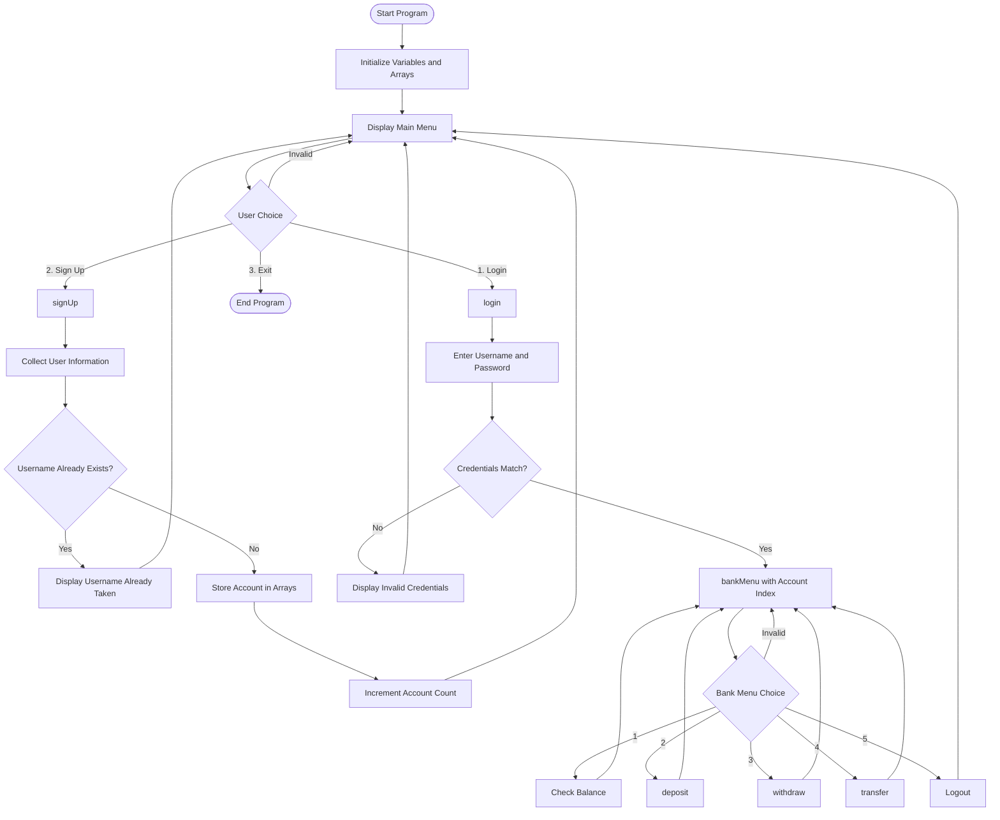
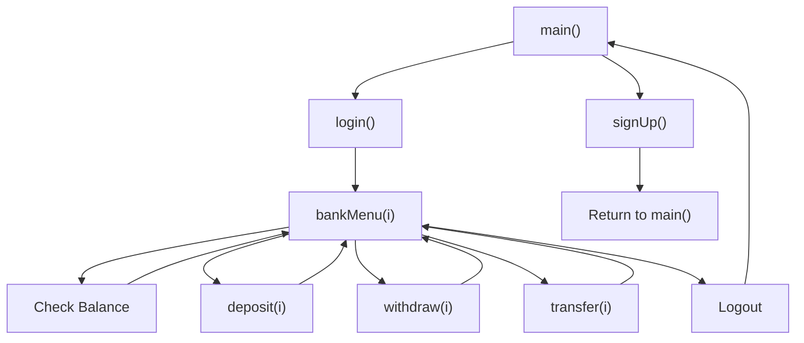

# Simple Banking System (Java)

A beginner-friendly console-based banking system developed using Java. This project demonstrates fundamental programming concepts such as arrays, methods, loops, conditional statements, method parameters, and basic data management without using Object-Oriented Programming (OOP).

---

## 1. System Overview

The Simple Banking System allows users to:

- Register a new bank account.
- Log in using their username and password.
- Check their account balance.
- Deposit money.
- Withdraw money.
- Transfer money to another registered account.
- Log out of their account.

The program uses parallel arrays to store account information and methods to organize different banking operations.

---

## 2. System Pipeline

The following flowchart illustrates the overall execution flow of the banking system.



### Pipeline Explanation

The system follows these stages:

1. **Initialization** - The program initializes the Scanner, arrays, and account counter.
2. **Main Menu** - The user chooses between Login, Sign Up, and Exit.
3. **Registration** - The system collects user information, validates the username, and stores the account.
4. **Authentication** - The system checks whether the entered username and password match an existing account.
5. **Banking Menu** - After successful authentication, the user can access banking operations.
6. **Banking Operations** - The user can check balance, deposit, withdraw, or transfer money.
7. **Logout** - The user exits the banking menu and returns to the main menu.

---

## 3. Data Storage Structure

The system uses parallel arrays to store information about registered accounts.

### Declared Arrays

```java
static String[] names = new String[100];
static String[] emails = new String[100];
static String[] usernames = new String[100];
static String[] passwords = new String[100];
static double[] balances = new double[100];

static int count = 0;
```

### Purpose of Each Array

| Array / Variable | Data Type | Purpose |
|---|---|---|
| names | String[] | Stores account holders' names |
| emails | String[] | Stores account holders' email addresses |
| usernames | String[] | Stores account usernames |
| passwords | String[] | Stores account passwords |
| balances | double[] | Stores account balances |
| count | int | Tracks the number of registered accounts |

### Understanding Parallel Arrays

All arrays use the same index to represent one account.

Example:

| Index | names | usernames | balances |
|---|---|---|---:|
| 0 | John | john123 | 500.00 |
| 1 | Mark | mark123 | 1000.00 |
| 2 | Anna | anna123 | 250.00 |

For example:

```java
names[0];
usernames[0];
balances[0];
```

All three values belong to John.

**Taglish Explanation:**

Imagine na mayroon tayong magkakahiwalay na storage cabinets. Each cabinet stores a different type of information, pero pare-pareho ang numbering ng drawers.

Kapag index 0 ang kinuha natin sa bawat array, makukuha natin lahat ng information ni John.

### Understanding the Account Counter

```java
static int count = 0;
```

The `count` variable determines how many accounts have been registered.

Every time a new account is successfully created:

```java
count++;
```

The counter increases by one.

For example:

- First account: index 0
- Second account: index 1
- Third account: index 2

Remember that Java arrays start at index 0.

---

## 4. Method Breakdown and Explanation

The program is divided into seven main methods.

| Method | Responsibility |
|---|---|
| `main()` | Controls the overall program execution |
| `signUp()` | Registers a new account |
| `login()` | Authenticates an existing account |
| `bankMenu(int i)` | Displays the banking operations |
| `deposit(int i)` | Adds money to an account |
| `withdraw(int i)` | Deducts money from an account |
| `transfer(int i)` | Transfers money between accounts |

### Stage 1: Main Method

```java
public static void main(String[] args)
```

This is the entry point of the Java application.

It displays the main menu and controls the overall execution of the system.

The main menu has three options:

- Login
- Sign Up
- Exit

The `while` loop keeps the application running until the user selects Exit.

**Taglish Explanation:**

Ito ang starting point ng program. Dito nagsisimula ang execution kapag ni-run natin ang Java application.

The main method also acts as the central controller because it determines which method should execute based on the user's choice.

### Stage 2: Sign Up Method

```java
public static void signUp()
```

This method handles account registration.

#### Process:

1. Ask for the user's name.
2. Ask for the user's email.
3. Ask for a username.
4. Check if the username already exists.
5. Ask for a password.
6. Store the information in the arrays.
7. Initialize the account balance to zero.
8. Increment the account counter.

Example:

```java
names[count] = name;
emails[count] = email;
usernames[count] = username;
passwords[count] = password;
balances[count] = 0;

count++;
```

**Taglish Explanation:**

Kapag nag-sign up ang user, kinukuha muna natin ang kanyang information.

Before saving the account, chine-check muna natin kung existing na ang username.

If available, ise-save natin ang information sa arrays using the current value of `count` as the index.

After successful registration, tataas ang `count` para sa next account.

### Stage 3: Login Method

```java
public static void login()
```

This method verifies the user's credentials.

#### Process:

1. Ask for the username.
2. Ask for the password.
3. Search through the registered accounts.
4. Compare the entered credentials with the stored credentials.
5. If both match, allow the user to access the banking menu.
6. Otherwise, display an error message.

The important condition is:

```java
if (usernames[i].equals(username) &&
    passwords[i].equals(password))
```

The `&&` operator means both conditions must be true.

**Taglish Explanation:**

Dito natin chine-check kung registered talaga ang user.

The `for` loop searches through the existing accounts.

Kapag parehong nag-match ang username at password, successful ang login.

The program then passes the account's index to the banking menu:

```java
bankMenu(i);
```

This allows the banking menu to identify which account is currently logged in.

### Stage 4: Banking Menu Method

```java
public static void bankMenu(int i)
```

This method serves as the controller of the banking operations.

It displays the following options:

1. Check Balance
2. Deposit
3. Withdraw
4. Transfer
5. Logout

The parameter `i` represents the index of the currently logged-in account.

For example:

```java
bankMenu(1);
```

This means that the banking menu will access the account stored at index 1.

**Taglish Explanation:**

Think of this method as the control center ng banking operations.

Hindi nito directly ginagawa lahat ng transactions. Instead, it calls the appropriate method depending on the user's choice.

For example:

```java
deposit(i);
withdraw(i);
transfer(i);
```

Notice that we pass the same index `i` because all operations must use the currently logged-in account.

### Stage 5: Deposit Method

```java
public static void deposit(int i)
```

This method adds money to the user's account.

The important operation is:

```java
balances[i] = balances[i] + amount;
```

Example:

- Current balance: 500
- Deposit amount: 300
- New balance: 800

The method also checks whether the deposit amount is greater than zero.

```java
if (amount <= 0) {
    System.out.println("Invalid amount.");
}
```

**Taglish Explanation:**

Simple lang ang deposit operation.

Kinukuha natin ang current balance, then ina-add natin ang deposit amount.

Pero before performing the transaction, chine-check muna natin kung valid ang amount.

### Stage 6: Withdraw Method

```java
public static void withdraw(int i)
```

This method deducts money from the user's account.

The important operation is:

```java
balances[i] = balances[i] - amount;
```

Before withdrawing, the system performs two validations:

1. The withdrawal amount must be greater than zero.
2. The withdrawal amount must not exceed the available balance.

Example:

- Current balance: 800
- Withdrawal amount: 300
- Remaining balance: 500

**Taglish Explanation:**

Unlike deposit, withdrawal subtracts money from the account.

Kailangan nating i-check kung valid ang amount at kung may sapat na balance ang user.

Hindi pwedeng mag-withdraw ng mas malaking amount kaysa sa available balance.

### Stage 7: Transfer Method

```java
public static void transfer(int i)
```

This method transfers money from one registered account to another.

Unlike deposit and withdrawal, transfer involves two accounts.

#### Important Variables

| Variable | Purpose |
|---|---|
| `i` | Index of the sender |
| `t` | Index of the recipient |
| `target` | Recipient's username |
| `amount` | Amount to be transferred |

#### Process:

1. Ask for the recipient's username.
2. Search for the recipient's account.
3. Check whether the recipient exists.
4. Prevent transferring to the same account.
5. Ask for the transfer amount.
6. Validate the amount and available balance.
7. Deduct money from the sender.
8. Add money to the recipient.

The most important operations are:

```java
balances[i] = balances[i] - amount;
balances[t] = balances[t] + amount;
```

Example:

| Account | Previous Balance | Transaction | New Balance |
|---|---:|---:|---:|
| John (Sender) | 1000 | -300 | 700 |
| Mark (Recipient) | 500 | +300 | 800 |

**Taglish Explanation:**

Ang transfer ay combination ng withdrawal at deposit.

Una, babawasan natin ang balance ng sender. Then, idaragdag natin ang same amount sa balance ng recipient.

That's why we need two indexes:

- `i` for the sender.
- `t` for the recipient.

---

## 5. Method Relationship

The following diagram shows how the methods interact with one another.



### Method Execution Flow

| Calling Method | Called Method | Purpose |
|---|---|---|
| `main()` | `signUp()` | Register an account |
| `main()` | `login()` | Authenticate a user |
| `login()` | `bankMenu(i)` | Access banking operations |
| `bankMenu(i)` | `deposit(i)` | Deposit money |
| `bankMenu(i)` | `withdraw(i)` | Withdraw money |
| `bankMenu(i)` | `transfer(i)` | Transfer money |

**Important:** When a method finishes executing, the program returns to the method that called it, unless the program terminates.

---

## 6. Programming Concepts Used

This project demonstrates several fundamental Java programming concepts.

| Concept | Application in the Project |
|---|---|
| Variables | Store temporary information such as `amount` and `choice` |
| Arrays | Store multiple users' account information |
| Parallel Arrays | Organize related account data using matching indexes |
| Methods | Separate different system operations |
| Method Parameters | Pass account indexes between methods |
| Loops | Repeat menus and search through accounts |
| Conditional Statements | Validate user choices and transactions |
| Logical Operators | Check multiple conditions using `&&` |
| Array Indexing | Access a specific user's information |
| Return Statement | Exit a method when necessary |
| Scanner | Receive input from the user |

---

## 7. Important Concepts to Understand

### A. Method Parameters

Example:

```java
public static void deposit(int i)
```

The `i` is a parameter.

It allows the method to receive an account index from another method.

When we execute:

```java
deposit(1);
```

The value `1` is passed to the parameter `i`.

### B. Array Indexing

Example:

```java
balances[i] = balances[i] + amount;
```

The index determines whose balance will be modified.

If `i = 1`, the program accesses:

```java
balances[1]
```

This is why passing the correct account index is important.

### C. Method Execution Flow

Example:

```java
login();
```

When this statement executes, Java enters the `login()` method.

After the method finishes, execution returns to the statement immediately after the method call.

This is how the different parts of the banking system work together.

---

## 8. System Limitations and Possible Improvements

Although this project demonstrates basic banking operations, there are limitations that can be improved in future versions.

| Current Limitation | Possible Improvement |
|---|---|
| Fixed array capacity of 100 accounts | Implement dynamic storage |
| Username duplication is checked, but not email duplication | Add email validation |
| Passwords are stored as plain text | Implement secure password hashing |
| No numeric input validation | Handle invalid input types |
| Account information is not permanently stored | Integrate a database |
| Uses `double` for monetary values | Use `BigDecimal` |
| No transaction history | Implement transaction records |
| No account recovery | Implement password recovery |

### Data Persistence

Currently, the system stores account information only in memory.

This means all registered accounts and balances will disappear when the application terminates.

A future version can use file handling or a database such as PostgreSQL to permanently store account information.

---

## 9. Conclusion

The Simple Banking System demonstrates how fundamental Java programming concepts can be combined to create a functional console-based application without using Object-Oriented Programming.

The most important concepts demonstrated in this project are:

1. **Arrays** - For storing multiple users and their information.
2. **Methods** - For separating different system operations.
3. **Loops** - For repeating menus and searching through accounts.
4. **Conditional Statements** - For handling decisions and validating transactions.
5. **Method Parameters** - For passing account indexes between different methods.

The key to understanding this system is learning how data moves between methods and how the same array index identifies a specific account throughout the application.

---

**Project Type:** Console-Based Application  
**Programming Language:** Java  
**Programming Approach:** Procedural Programming (Without OOP)  
**Storage:** In-Memory Parallel Arrays
